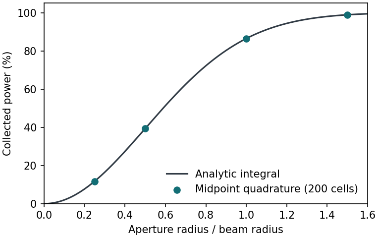

# 居中高斯光斑的圆孔收集功率

## 摘要

接收平面的强度图给出光功率的空间分布，接收机读数还取决于孔径。本算例对理想高斯光斑作径向数值积分。在孔径半径等于光束半径时，积分得到的收集功率占总功率的 86.47%。从这一半径起，孔径每增加相同宽度，新增环带收集的功率逐渐减少。

## 引言

在跨介质上行传播模拟中，Gao 等用接收平面的二维功率图和横截面剖面比较不同海面模型的预测[1]。要从类似的空间图得到接收孔径内的功率，还需要规定孔径大小及其相对于光斑的位置。为说明这个积分步骤，我们考察一个具有解析解的居中圆对称光斑。

## 方法

设接收平面的强度为 $I(r)=I_0\exp(-2r^2/w^2)$，其中 $w$ 是强度降至轴上值 $e^{-2}$ 倍时的半径。将半径为 $a$ 的理想圆孔与光轴对准，以无限大平面收集的功率为分母。令 $u=r/w$，则收集比例为 $\eta=\int_0^{a/w}4u\exp(-2u^2)\,du$。对每个孔径用 200 个等宽环带的中点求积，并用解析值 $1-\exp[-2(a/w)^2]$ 检查。所有结果均来自这个确定性模型。

## 结果

孔径半径为 $0.5w$ 时，收集比例为 39.35%。孔径增至 $w$ 时，收集比例升至 86.47%。继续增至 $1.5w$，收集比例达到 98.89%。图 1 中的积分点在绘图精度内与解析曲线重合。在所列半径中，200 个环带与解析积分的最大绝对差小于 0.002 个百分点。

图 1　居中圆孔收集的光功率。连续曲线为解析解，离散点为 200 个环带的中点积分值。各点分母均为无限接收平面上的总功率。

## 讨论与结论

孔径从 $0.5w$ 增到 $w$ 时覆盖了仍有较高强度的环带。从 $w$ 增到 $1.5w$ 时，新增面积更大，增加的功率却更小。收集比例本身不能给出最佳接收孔径。计算最优孔径还需要指定背景光、噪声、光斑偏移和接收性能指标。本算例提供了检查数值积分与功率归一化的解析基准，未模拟海面或现场信道。

## 参考文献

[1] Gao H, Zhang T, Yuan R, Hu L, Chen S. Modeling and Performance Analysis of Uplink Laser Transmission Across Sea Surfaces: A Channel Characterization Study. *Sensors*, 2025, 25, 1239. [论文全文](https://www.mdpi.com/1424-8220/25/4/1239)
